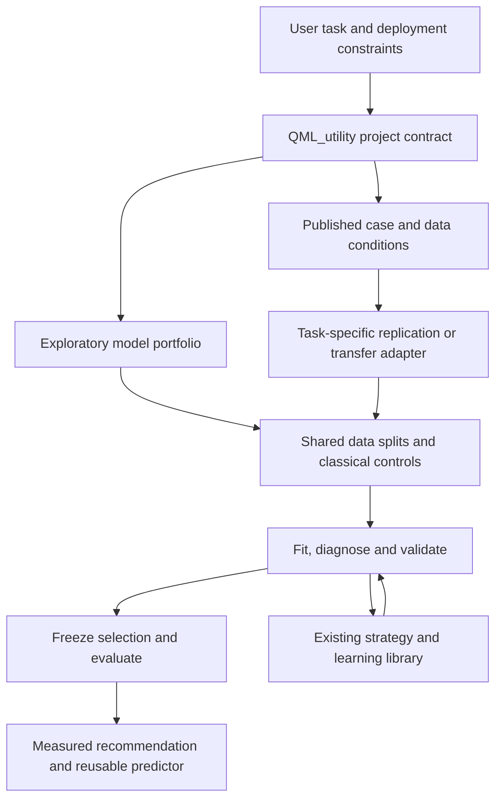

# One repository with a practical entry point and a preserved research library

The application layer should answer "what should my agent try, and how will we
know whether it helped?" The existing repository answers detailed questions
about circuits, trainability, estimators, surrogate models and published studies.
Keep both, with a clear handoff rather than copying or relabeling old material.

## Responsibilities

| Existing asset | Its continuing role | Utility entry point |
|---|---|---|
| Trainability and encoding strategies | Scoped mathematical mechanisms and independent three-SDK references | [Companion map](companion_map.json) and [composition guide](COMPOSING_METHODS.md) |
| Learning methods and estimator recipes | QNG/gradients/shots, pretraining, warm starts, Nyström, offline surrogates and generative learning | Trigger and obligation for each companion |
| Original benchmark and reproduction records | Immutable observations with their original controls and limits | [Contextual outcomes](experiment_outcomes.json) and new prespecified follow-ups |
| Published successful-case research | Task/data/access evidence and replication requirements | [Case selection](CASE_SELECTION.md), evidence cards and protocols |
| New practical implementations | Reusable estimators, task routing, split-aware comparison and model artifacts | [Practical workflow](PRACTICAL_WORKFLOW.md) |

All new utility code, docs, tests and artifacts stay under `QML_utility`. This
folder is the entry point in the same distribution as `qml_tricks`; essentials
execute its canonical strategies and supervised QNG reuses its geometry. The
companion map records additional composition obligations. The existing generated
strategies retain their original `scripts/assemble*.py` source of truth.

## What to feature when the project is presented

Lead with a problem-to-model example, actual command, sample comparison report,
implementation coverage and known limits. Put published successes next to their
data conditions. Give the technical strategy library a prominent "understand
and improve the model" route. Preserve previous studies as evidence, including
their bounded non-wins. Avoid a headline that suggests every QML project has a
known winning recipe.

The root README/site lead into the utility, while the full research library is
preserved. Utility documentation is included in the site directly from these
canonical files, without a second authored copy under docs/.
Independent paper reruns are an optional research track; the published-method
collection is usable with peer-reviewed evidence and documented source access.
See [evidence levels](EVIDENCE_LEVELS.md) for the per-case routes.

## Current readiness and next implementation priorities

| Capability | Current state | Next useful increment |
|---|---|---|
| Numeric classification and scalar regression | Four-family three-SDK reference, batched fixed features, repeated/group holdouts and expanding time windows | Larger-scale/adaptive training, confirmatory external evaluation and wider classical search |
| Long continual streams and graphon reconstruction | Published scoped cases, pinned author code and exact replication plans | Recover and reproduce full original trajectories in isolated environments |
| Short text, molecular reservoirs and volatility | Scoped evidence with source discrepancies and data obligations | Resolve artifacts before a verified task-specific adapter |
| Quantum state/channel acquisition | Native small-system identities and the restricted late-query audit | Hardware measurement/calibration adapters with full cost records |
| Raw images/text and categorical features | Explicit adaptation contract; existing pretraining companion | Utility-native train-only encoder and same-feature head comparisons |
| QPU deployment | No automatic submission in this folder | Backend execution contracts, finite-shot uncertainty and noise-aware comparisons |
| Offline teacher distillation | Utility-native feature mapper, frozen supported heads, empirical export gates and SDK-free student inference | Domain-shift stress tests and provider-specific measured-feature adapters |
| Installation/release | One root distribution for both packages, shared CLI routes and Linux/Windows CI | Broader environment testing and versioned releases |

More case cards alone will not close these gaps. Prioritize reproducible adapters,
strong controls and verifiable outputs over a larger collection of model names.
