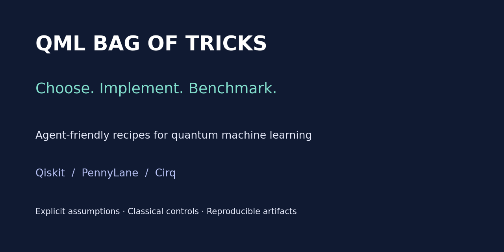
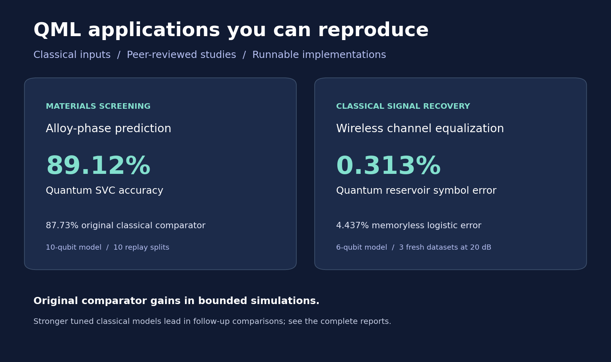

# QML Bag of Tricks



**Explore reproduced QML applications. Choose a trainable method. Build it with your coding agent.**

Runnable Qiskit, PennyLane and Cirq recipes connect scientific assumptions to
native circuits, complete learning workflows and reproducible reports. Start
from an application, understand why the quantum model helps, then benchmark
predictive quality and cost on your own project.

## Why explore quantum machine learning?

Published applications give concrete reasons to test quantum feature maps and
quantum models with temporal memory. We reproduced numerical comparisons from
two peer-reviewed papers using **classical application inputs**:

| Application | Reproduced quantum result | Original classical comparator | Why try it? |
|---|---|---|---|
| [Alloy-phase prediction — Matter (2024)](docs/reproductions/alloys.md) | **89.12% accuracy** | 87.73% for the best original comparator in this replay | Explore a fidelity kernel for small materials-screening datasets |
| [Wireless channel equalization — Nature Communications (2024)](docs/reproductions/communications.md) | **0.313% symbol error** | 4.437% for memoryless logistic regression | Learn a nonlinear temporal response with a fixed reservoir and classical readout |



The alloy comparison uses ten replay splits for the ten-qubit model; all 20
quantum replay scores across eight and ten qubits match their archived seeds.
Channel equalization uses three fresh simulated message datasets at 20 dB.
These reproduce gains over the **original comparators**. Stronger tuned classical
models lead in our follow-up comparisons, documented alongside the full results
in the [reproduction report](docs/reproductions/results.md). No hardware speedup
is established by these bounded simulations.

[Why and when to use QML](docs/why_qml.md) connects these motivations to method
selection, trainability and implementation. For quantum inputs, the
[two-copy state-learning example](docs/applications/experimental_learning.md)
adds a conditional acquisition benefit: **100% vs 49.14%** mean balanced accuracy
on the tested late-query, eight-qubit, 512-copy task.

## More published applications to explore

The [application catalog](docs/use_cases/index.md) adds three peer-reviewed
leads, with implementation plans and benchmark contracts for coding agents:

| Application | Published comparison | Explore it for |
|---|---|---|
| [Satellite-image classification](docs/use_cases/earth_observation.md) | **95.8% accuracy** vs 94.9% for DenseNet; 93.5% for the matched classical multitask model | A compact quantum image head when labels are scarce |
| [Molecular carcinogenicity](docs/use_cases/molecular_toxicity.md) | **0.8614 ROC-AUC** vs 0.8258 for LightAutoML | Annealer-based weak-learner selection on a small endpoint |
| [Hyperparameter search](docs/use_cases/hyperparameter_search.md) | **2,960 training epochs** vs 3,014 with classical SVR prediction | Reducing expensive neural-network training work |

**These additions are reported paper results, not local reproductions.** The
image comparison uses a reduced noiseless-simulator benchmark. The molecular
gain is one of ten endpoints; the classical model leads on the other nine.
The search comparison measures epochs, with aggregation and hardware overhead
requiring separate controls. The latter two methods use quantum annealing.
Each guide states code/data readiness, exact result locations, required
classical controls and resource costs. Agents can also read the
[structured evidence catalog](docs/use_cases/catalog.json).

## Start with one complete project

| Goal | Executed walkthrough |
|---|---|
| Classify real tabular observations | [Classification notebook](notebooks/01_classification.ipynb) |
| Regress a real numerical target | [Regression notebook](notebooks/02_regression.ipynb) |
| Train a quantum teacher, deploy a classical student | [Offline distillation notebook](notebooks/03_offline_surrogate.ipynb) |

Use Python 3.12, clone this repository, then install **one** SDK first:

```bash
python -m venv .venv
# Activate .venv using your shell.
python -m pip install -e ".[qiskit,learning,notebooks]"
python -m qml_tricks benchmark --task classification --framework qiskit --output results/local/report.json
```

For a browser interface, install JupyterLab and open `notebooks/`.
[Walkthrough instructions and troubleshooting](docs/tutorials.md) cover local
execution and public Colab setup once a repository destination is configured.
Install `.[all,learning]` when you want all three SDKs.

## Reproduce the applications

From the source checkout, run the classical-input paper examples:

```bash
python -m qml_tricks.learning.paper_reproductions --study alloys
python -m qml_tricks.learning.paper_reproductions --study communications
```

The [reproduction guide](docs/reproductions/index.md) covers pinned author data,
reference archives, the stronger-control extensions and independent audits.
Qiskit, PennyLane and Cirq construct the alloy feature map independently. The
reservoir simulation uses exact SciPy dynamics with native SDK equivalence checks.

Additional reports remain available for deeper evaluation:

- [Application benchmarks](docs/applications/results.md): periodic calibration,
  quantum-state characterization, learning curves and copy/shot budgets.
- [Initial tabular baseline study](docs/study.md): all earlier configurations,
  classical comparisons, uncertainty and costs.
- [Agent implementation evaluation](docs/agent_evaluation.md): five project tasks
  independently rerun and checked, with their limits stated.

## Choose a method

- [Task-based selector](docs/index.md): local losses, identity blocks, Gaussian
  initialization, QCNNs, tensor architectures and symmetries.
- [Learning workflows](docs/learning/index.md): parameter-shift, re-uploading,
  kernels, frozen features, SPSA, shot allocation, shadows and generative learning.
- [Kipu-style offline distillation](docs/learning/kipu_workflow.md): a frozen trained
  teacher, measured feature pairs and fidelity-gated classical export.
- [Evidence and gaps](docs/coverage.md): formal scopes, restricted demonstrations
  and engineering companions are labeled separately.

The collection contains **19 circuit-strategy guides and 14 learning guides**.
Its **99 native entrypoints share mathematical utilities**; they are not 99
distinct algorithms or complete reproductions of every cited theorem.

## Give this contract to your agent

> Use this repository to fit a model to my dataset. Split before preprocessing,
> select settings using validation data only, include classical controls, save
> predictions and model artifacts, and report held-out metrics, uncertainty and
> resources. State the mathematical assumptions. Preserve negative results;
> do not infer quantum advantage from a small simulator experiment.

[Five executable project tasks](agent_eval/tasks.json) and their saved solutions
demonstrate the workflow. The quantum-state example uses known simulator
preparation descriptions; hardware state-copy access is a different interface.
Finite-shot modes simulate measurements on the host. No QPU account is required.

## Validate and contribute

```bash
python -m pip install -e ".[all,learning,notebooks,dev,docs]"
python -m pytest
python scripts/run_notebooks.py
python -m mkdocs build --strict
```

See [validation](VALIDATION.md), [contributing](CONTRIBUTING.md), the
[bibliography](references.bib) and [citation metadata](CITATION.cff).
Code uses the [MIT license](LICENSE).

**Release status: 0.2.0 candidate; owner scientific review pending.**
The [review packet](docs/owner_review.md) and [release notes](RELEASE_NOTES.md)
identify measured results and remaining obligations. The docs build locally;
the [GitHub repository](https://github.com/FyodorAmanov1/QML_bag_of_tricks) is
private for owner review. Public documentation and Colab access are pending.
