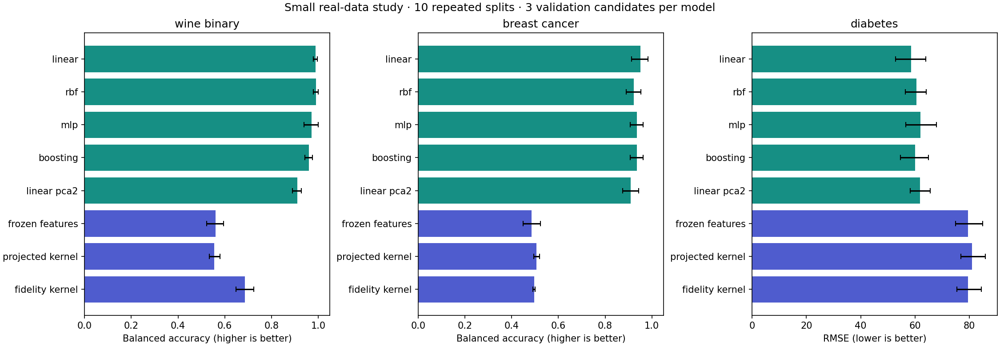

# QML Bag of Tricks


**Choose a QML method, implement it with your coding agent, and compare it with classical ML.**

Runnable Qiskit, PennyLane and Cirq recipes connect scientific assumptions to
native circuits, complete learning workflows and reproducible reports. Inspect
predictive quality **and** cost before deciding whether a method fits your project.

## Start with one complete project

| Goal | Executed walkthrough |
|---|---|
| Classify real tabular observations | [Classification notebook](notebooks/01_classification.ipynb) |
| Regress a real numerical target | [Regression notebook](notebooks/02_regression.ipynb) |
| Train a quantum teacher, deploy a classical student | [Offline distillation notebook](notebooks/03_offline_surrogate.ipynb) |

Use Python 3.12, clone this repository, then install **one** SDK first:

```bash
python -m venv .venv
# Activate .venv using your shell.
python -m pip install -e ".[qiskit,learning,notebooks]"
python -m qml_tricks benchmark --task classification --framework qiskit --output results/local/report.json
```

For a browser interface, install JupyterLab and open `notebooks/`.
[Walkthrough instructions and troubleshooting](docs/tutorials.md) cover local
execution and public Colab setup once a repository destination is configured.
Install `.[all,learning]` when you want all three SDKs.

## What does the evidence show?

For classical application data, the [paper reproduction suite](docs/reproductions/index.md)
tests published alloy-phase prediction and wireless channel equalization studies.
It distinguishes archived-number recovery, fresh simulations and comparisons
against stronger tuned classical models. See the [complete reproduction report](docs/reproductions/results.md).

The [application benchmarks](docs/applications/index.md) now test useful
structure explicitly: periodic sensor calibration and late-query quantum-state
characterization. Across ten seeds, the eight-qubit, 512-copy state experiment
reached **100% mean balanced accuracy** with two-copy Bell acquisition, compared
with **49.14%** for the optimal classifier on the tested random single-copy local
records. Both use the same number of state copies; Bell acquisition needs twice
as many simultaneous qubits. This is a simulated, restricted quantum-input task.
Knowing the query before acquisition removes the observed gap.

Periodic quantum features also improve on generic regularized regressors in a
held-out-period task, while cheap classical Fourier features match them. The
[complete application report](docs/applications/results.md) retains all 280
configurations and 1,720 base evaluations, including these decisive controls.



The small real-data study evaluates eight pipelines on three datasets, with ten
split seeds and three validation candidates per model. **The tested classical
configurations outperform these two-qubit quantum-feature configurations on mean
predictive scores.** This describes the recorded settings, not all QML.

Read the [complete study, uncertainty and costs](docs/study.md), including the
two-feature classical control, warnings and untouched-test protocol. All three
notebooks have executed outputs. Five agent project tasks were independently
rerun and passed bounded acceptance checks; the [agent evaluation](docs/agent_evaluation.md)
states the limitations of that evidence.

## Choose a method

- [Task-based selector](docs/index.md): local losses, identity blocks, Gaussian
  initialization, QCNNs, tensor architectures and symmetries.
- [Learning workflows](docs/learning/index.md): parameter-shift, re-uploading,
  kernels, frozen features, SPSA, shot allocation, shadows and generative learning.
- [Kipu-style offline distillation](docs/learning/kipu_workflow.md): a frozen trained
  teacher, measured feature pairs and fidelity-gated classical export.
- [Evidence and gaps](docs/coverage.md): formal scopes, restricted demonstrations
  and engineering companions are labeled separately.

The collection contains **19 circuit-strategy guides and 14 learning guides**.
Its **99 native entrypoints share mathematical utilities**; they are not 99
distinct algorithms or complete reproductions of every cited theorem.

## Give this contract to your agent

> Use this repository to fit a model to my dataset. Split before preprocessing,
> select settings using validation data only, include classical controls, save
> predictions and model artifacts, and report held-out metrics, uncertainty and
> resources. State the mathematical assumptions. Preserve negative results;
> do not infer quantum advantage from a small simulator experiment.

[Five executable project tasks](agent_eval/tasks.json) and their saved solutions
demonstrate the workflow. The quantum-state example uses known simulator
preparation descriptions; hardware state-copy access is a different interface.
Finite-shot modes simulate measurements on the host. No QPU account is required.

## Validate and contribute

```bash
python -m pip install -e ".[all,learning,notebooks,dev,docs]"
python -m pytest
python scripts/run_notebooks.py
python -m mkdocs build --strict
```

See [validation](VALIDATION.md), [contributing](CONTRIBUTING.md), the
[bibliography](references.bib) and [citation metadata](CITATION.cff).
Code uses the [MIT license](LICENSE).

**Release status: 0.2.0 candidate; owner scientific review pending.**
The [review packet](docs/owner_review.md) and [release notes](RELEASE_NOTES.md)
identify measured results and remaining obligations. The docs build locally;
the [GitHub repository](https://github.com/FyodorAmanov1/QML_bag_of_tricks) is
private for owner review. Public documentation and Colab access are pending.
