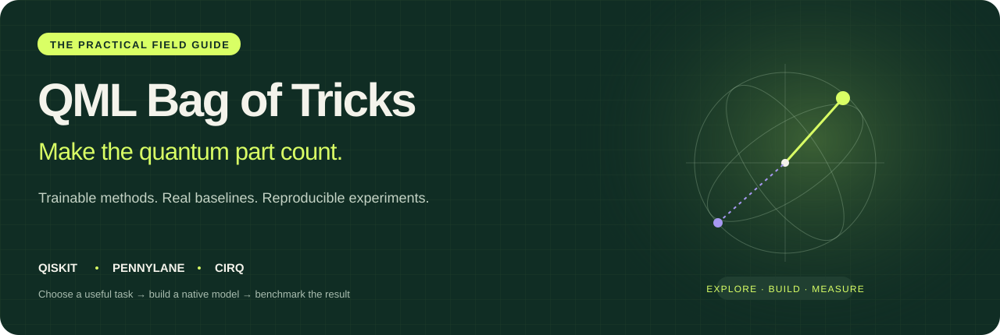

<p align="center">
  
</p>

<p align="center">
  <strong>A practical QML field guide for ML engineers and coding agents.</strong><br>
  Find a reason to try quantum machine learning. Build the model. Measure what helps.
</p>

<p align="center">
  <a href="QML_utility/UNIFIED_SETUP.md">Start with QML Utility</a> ·
  <a href="#why-qml-is-worth-testing">Why QML?</a> ·
  <a href="#results-worth-exploring">Results</a> ·
  <a href="#run-your-first-experiment">Get started</a> ·
  <a href="https://fyodoramanov1.github.io/QML_bag_of_tricks/">Website and guides</a> ·
  <a href="https://fyodoramanov1.github.io/QML_bag_of_tricks/explore/">Explore documentation</a> ·
  <a href="https://fyodoramanov1.github.io/QML_bag_of_tricks/agents/">Use with your agent</a> ·
  <a href="docs/use_cases/models.md">Model APIs</a>
</p>

<p align="center">
  <strong>19</strong> circuit strategies &nbsp; / &nbsp;
  <strong>14</strong> learning guides &nbsp; / &nbsp;
  <strong>3</strong> native SDKs &nbsp; / &nbsp;
  <strong>2</strong> paper reproductions &nbsp; / &nbsp;
  <strong>6</strong> further published cases
</p>

## Start in five minutes

Use Python 3.12. Clone once and install once from the repository root:

```bash
git clone https://github.com/FyodorAmanov1/QML_bag_of_tricks.git
cd QML_bag_of_tricks
python -m venv .venv
```

Activate with `.venv\Scripts\Activate.ps1` in PowerShell or
`source .venv/bin/activate` in bash, then:

```bash
python -m pip install -e ".[qiskit]"
python -m qml_tricks project doctor
python -m qml_tricks project setup --output results/local/setup --check-essentials
python -m qml_tricks project quickstart --output results/local/first_run
```

Open `results/local/first_run/run/REPORT.md`. This bundled comparison needs no
QPU account or dataset download; it verifies integration, not quantum advantage.
Use fresh output directories for subsequent runs. Replace the extra with
`pennylane` or `cirq` and pass the matching `--framework` to setup and quickstart.

**One project, two layers, one installation:** `qml-tricks project <command>`
and `qml-utility <command>` execute the same Utility code. For environments
without console scripts, `python -m qml_tricks project <command>` and
`python -m QML_utility <command>` are equivalent. The core research commands
remain `qml-tricks list`, `run` and `sweep`; `qml-utility research <command>`
reaches those same commands. Use `--help` at either layer.

Read [the complete starter guide](QML_utility/START_HERE.md),
[the command and architecture map](QML_utility/UNIFIED_SETUP.md#command-map),
or [the publication audit and known limits](QML_utility/PUBLIC_READINESS.md).

## Why QML is worth testing

**Start with [QML Utility](QML_utility/START_HERE.md), the entry point to this
single project.** It connects published-case protocols, core training methods,
model fitting and evaluation to the research library below. One installation
provides both `qml-utility` and `qml-tricks`:

```bash
python -m pip install -e ".[qiskit]"
qml-utility setup --output QML_utility/results/local/my_setup --check-essentials
```

Setup exposes the published-case catalog alongside **quantum natural gradient
descent, local costs, identity-block initialization and near-identity encoding**.
It prepares a project contract and can execute the main library's canonical
strategy/control checks. QNG is also selectable in supervised training.
[Unified setup guide](QML_utility/UNIFIED_SETUP.md) ·
[All practical workflows](QML_utility/PRACTICAL_WORKFLOW.md).

On the website, choose **Start with QML Utility** in the persistent navigation
or open the [unified setup](https://fyodoramanov1.github.io/QML_bag_of_tricks/utility/unified_setup/).
The homepage links case selection, training, evaluation and the preserved
research library. Repository pushes and website publication are separate:
the [manual Pages workflow](docs/release.md#publish-the-documentation-site)
must be run to update the live documentation.

Published successes apply to their stated task and comparator. Core training
tools have their own assumptions; they do not guarantee a new-project advantage.

Quantum models offer several concrete hypotheses for an ML project:

| Opportunity | Where to try it | What makes the experiment useful |
|---|---|---|
| **A different similarity geometry** | Small materials, molecular or tabular datasets | Compare a quantum fidelity kernel with tuned conventional kernels and domain features |
| **Temporal features from physical dynamics** | Nonlinear signals and streaming data | Train a classical readout on a fixed quantum reservoir and compare equally informed classical memories |
| **Compact, structured representations** | Hybrid image models and constrained quantum heads | Use structure, local readout and a measured loading budget to keep the quantum part manageable |
| **Better acquisition of quantum data** | State characterization with late observable queries | Test coherent multi-copy measurements under matched state-copy access |
| **A useful hybrid workflow** | Ambiguous record matching, learning-curve prediction and offline deployment | Isolate the contribution of routing, representation, quantum queries and classical training |

An $n$-qubit register represents $2^n$ amplitudes. That space becomes useful
when preparation is structured and a compact readout answers the task. Loading,
shots, noise and classical alternatives decide whether the full workflow pays.
The [motivation guide](docs/why_qml.md) connects each opportunity to methods and costs.

## Results worth exploring

### Two classical-input comparisons reproduced here

These bounded simulations recover gains over the papers' original comparators.
The stronger tuned classical follow-ups are preserved alongside them.

<!-- showcase:reproductions:start -->
| Application | Quantum result | Classical comparison | Evidence and scope |
|---|---|---|---|
| [Predict alloy phases](docs/reproductions/alloys.md) | **89.12%** · Accuracy ↑ | 87.73% · best original classical comparator | Local comparator replay. 10-qubit replay, 10 splits. Stronger tuned classical models lead in follow-up comparisons. |
| [Recover a wireless signal](docs/reproductions/communications.md) | **0.313%** · Symbol error ↓ | 4.437% · memoryless logistic error | Local comparator replay. 6 qubits, 3 fresh simulated datasets at 20 dB. Stronger causal classical controls lead. |
<!-- showcase:reproductions:end -->

The alloy figure uses ten replay splits for the ten-qubit model. All 20 fresh
quantum replay scores across eight and ten qubits match their archived seeds.
The communications example uses three fresh simulated datasets at 20 dB.
[Protocols, pinned data and complete comparisons →](docs/reproductions/index.md)

### Six more peer-reviewed reasons to experiment

These are **published results**. Three have runnable reduced adaptations here;
those local runs have their own outcomes and do not reproduce the paper gains.

<!-- showcase:papers:start -->
| Application | Quantum result | Classical comparison | Evidence and scope |
|---|---|---|---|
| [Classify satellite images](docs/use_cases/earth_observation.md) | **95.8%** · test accuracy ↑ | 94.9% · DenseNet | Published result. Simplified simulator benchmark; large CNNs were reference comparisons under lightweight training settings. |
| [Screen a molecular endpoint](docs/use_cases/molecular_toxicity.md) | **0.8614** · ROC-AUC ↑ | 0.8258 · LightAutoML | Published result. The positive endpoint is one of ten ADMET datasets; LightAutoML leads on the other nine. |
| [Spend fewer training epochs](docs/use_cases/hyperparameter_search.md) | **2,960** · target-model training epochs ↓ | 3,014 · Swift-Hyperband SVR epochs | Published result. Epoch counts exclude end-to-end annealer overhead; gains over classical prediction are task dependent and aggregation is a confound. |
| [Match ambiguous records](docs/use_cases/entity_matching.md) | **96.5%** · test accuracy ↑ | 94.0% · TF-IDF | Published result. The win is for the combined pipeline on an extended hard-case test; standalone HQNN scores 0.887 there and Osaka hardware evaluation is lower. |
| [Choose a multiclass kernel](docs/use_cases/multiclass_kernel.md) | **Higher mean CV accuracy** · Figure-only comparison | Tested linear, polynomial, sigmoid and Gaussian SVMs | Published result. Figure-only paired comparisons are not transcribed as exact numbers; the Pauli product kernels also have an efficient exact classical formula. |
| [Study attack transfer](docs/use_cases/adversarial_qvc.md) | **Greater transfer resilience** · Figure-only comparison | Tested ConvNet / ResNet18 targets | Published result. A transfer-attack benefit is distinct from white-box robustness: attacks optimized directly against QVCs remain effective. |
<!-- showcase:papers:end -->

[Application catalog and primary sources →](docs/use_cases/index.md)

### A separate opportunity with quantum inputs

Our late-query state-learning prototype reaches **100% versus 49.14% mean
balanced accuracy** on the tested eight-qubit, 512-copy task. Bell acquisition
retains information lost by the specified single-copy local records, including
their optimal inference control. It needs 16 simultaneously coherent qubits
for the two copies; knowing the
query early removes this gap. [Access model and full results →](docs/applications/experimental_learning.md)

The [periodic-calibration prototype](docs/applications/ramsey_calibration.md)
adds a useful control: its quantum Fourier features have an identical cheap
classical implementation. Preserve that equivalence when interpreting a gain.

## Run your first experiment

Use Python 3.12, clone this repository and install one SDK:

```bash
python -m venv .venv
# Activate .venv using your shell.
python -m pip install -e ".[qiskit,learning]"
qml-utility setup --output QML_utility/results/local/first_setup --check-essentials
qml-utility run --config QML_utility/results/local/first_setup/project.json --output QML_utility/results/local/first_comparison
```

Use `.[pennylane,learning]` or `.[cirq,learning]` and pass the matching
`--framework` to setup. Install `.[all,learning]` for the full SDK matrix.

The existing application entrypoints remain available; for example:

```bash
python -m qml_tricks.learning.case_models --case multiclass_kernel --framework qiskit --output results/local/multiclass.json
```

| Build this | Start here |
|---|---|
| A multiclass quantum-kernel classifier | `--case multiclass_kernel` · [Guide](docs/use_cases/multiclass_kernel.md) |
| A hybrid matcher with TF-IDF triage | `--case entity_matching` · [Guide](docs/use_cases/entity_matching.md) |
| A QVC and cross-model attack matrix | `--case adversarial_qvc` · [Guide](docs/use_cases/adversarial_qvc.md) |
| An end-to-end dataset project | [Classification](notebooks/01_classification.ipynb), [regression](notebooks/02_regression.ipynb), [offline surrogate](notebooks/03_offline_surrogate.ipynb) |
| An original-comparator paper replay | `python -m qml_tricks.learning.paper_reproductions --study alloys` or `--study communications` |

The [model API guide](docs/use_cases/models.md) covers custom data and nine saved
reference runs. The heads use short reference training; benchmark quality and
cost before adapting them to a project. [Installation and walkthrough help →](docs/tutorials.md)

## Make the quantum model trainable

| Your next decision | Repository support |
|---|---|
| Start from a useful reference | [Near-identity encoding](docs/strategies/near_identity_encoding.md), [identity blocks](docs/strategies/identity_block_init.md), [Gaussian initialization](docs/strategies/gaussian_init.md) |
| Keep the objective measurable | [Local costs](docs/strategies/local_loss.md), [QCNNs](docs/strategies/qcnn.md), [structure-based method selector](docs/method_selector.md) |
| Improve optimization when gradients are resolvable | [Quantum natural gradient](docs/strategies/natural_gradient.md), [parameter-shift](docs/learning/parameter_shift.md), [SPSA](docs/learning/spsa.md) |
| Reuse classical work | [Classical pretraining and warm starts](docs/learning/pretraining_surrogates.md) |
| Deploy a trained teacher through a classical student | [Kipu-style offline feature distillation](docs/learning/kipu_workflow.md), with held-out fidelity gates and zero-query inference checks |

Every strategy separates its published guarantee from its executable scope.
The **99 native recipe entrypoints** share mathematical utilities; they are not
99 distinct algorithms. Three additional application classes have nine native
state constructors. [Evidence coverage →](docs/coverage.md)

## Give your agent a benchmark contract

The website's [documentation directory](https://fyodoramanov1.github.io/QML_bag_of_tricks/explore/)
lists every guide, including all technical circuit methods. The
[agent integration guide](https://fyodoramanov1.github.io/QML_bag_of_tricks/agents/)
provides copyable project briefs for **public website access** and an
**authorized local checkout**, plus setup commands and expected deliverables.
For a compact machine-readable entry point, use
[llms.txt](https://fyodoramanov1.github.io/QML_bag_of_tricks/llms.txt).
The static website provides documentation and linked reference sources;
the full package can be installed from a public clone using the commands above.

> Split before preprocessing. Choose settings using validation data only.
> Include regularized and domain-informed classical controls. Save predictions,
> artifacts, uncertainty and loading/readout/shot costs. State the access model
> and the paper-to-code differences. Preserve unsuccessful results. Accept a
> quantum gain only for the tested endpoint and comparator.

[Five executed agent tasks](agent_eval/tasks.json), [full application results](docs/applications/results.md)
and the [initial tabular study](docs/study.md) show how this works in practice.
The source reports retain stronger classical results, failed configurations and
warnings. The collection establishes no general hardware or runtime advantage.

## Website, validation and contributions

The [public website](https://fyodoramanov1.github.io/QML_bag_of_tricks/) includes
an evidence gallery, project selector, SDK commands and the complete guide
library. Its visual design takes inspiration from [KETS Quantum](https://kets-quantum.com/):
white and cool-gray surfaces, black-and-red typography, and spacious sections.
The matching banner and locally served Poppins fonts carry that style through
the repository. A visible documentation bar, complete guide directory and
copyable agent handoffs make the technical library accessible without search.
The source repository is public. Preview locally:

```bash
python -m pip install -e ".[docs]"
python scripts/build_showcase.py --check
python -m mkdocs serve
```

The GitHub Pages workflow builds a downloadable preview by default.
Publishing a new live website build remains a separate explicit workflow option. [Hosting and release instructions →](docs/release.md)

```bash
python -m pip install -e ".[all,learning,notebooks,dev,docs]"
python -m pytest
python -m mkdocs build --strict
```

Contribute a reproduction, a stronger control, a useful dataset report or a
clearer implementation. See [contributing](CONTRIBUTING.md), [validation](VALIDATION.md),
[bibliography](references.bib) and [citation metadata](CITATION.cff).
Code is [MIT licensed](LICENSE).

**0.2.0 candidate · owner scientific review pending.**
[Review packet](docs/owner_review.md) · [Release notes](RELEASE_NOTES.md)
