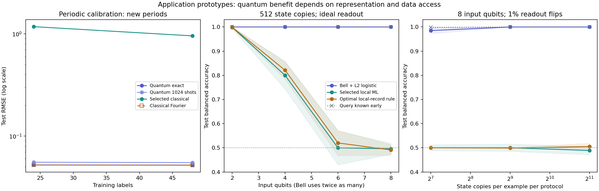

# Application benchmark results



The fixed protocol produced **280 configurations** over 10 independent data-generation seeds, **1720 base model/control evaluations**, 0 failed final evaluations and 0 failed tuning candidates. Pooled classical-champion rows reuse the validation-selected family result and are not additional independent evaluations. The recorded run took 182.2 seconds on its recorded machine.

All 221 candidate warnings are retained in the JSON report. A convergence warning is not silently counted as a failed or successful convergence proof. Figures and tables include all pre-specified grids, not just winning settings. Curves are seed means; shaded bands in the state-learning panels show plus/minus one seed standard deviation.

## Periodic calibration: representation benefit and its classical explanation

Lower RMSE is better. The quantum feature bank and cheap classical Fourier bank implement the same functions in the exact limit. The conventional champion is selected using validation scores from Ridge, Elastic Net, RBF-SVR, L2-MLP and boosting. It gets a 45-candidate pooled search; each individual family and the quantum readout get nine.

| Training labels | Shots/setting | Quantum Ridge | Selected classical | Fourier Ridge | Ridge | Elastic Net | RBF-SVR | L2-MLP | Boosting |
|---|---|---:|---:|---:|---:|---:|---:|---:|---:|
| 24 | exact | 0.0521 | 1.1784 | 0.0521 | 0.7220 | 0.7659 | 0.5597 | 2.3931 | 0.7233 |
| 24 | 1024 | 0.0555 | 1.1784 | 0.0521 | 0.7220 | 0.7659 | 0.5597 | 2.3931 | 0.7233 |
| 48 | exact | 0.0520 | 0.9573 | 0.0520 | 0.6805 | 0.7440 | 0.5607 | 2.6015 | 0.7251 |
| 48 | 1024 | 0.0550 | 0.9573 | 0.0520 | 0.6805 | 0.7440 | 0.5607 | 2.6015 | 0.7251 |

Positive paired gain below means the quantum pipeline had **lower RMSE**. These are descriptive seed-bootstrap intervals, not corrected significance tests.

| Training labels | Mode | Gain over validation-selected classical | Gain over Fourier-Ridge |
|---|---|---|---|
| 24 | exact | 1.1263 [0.5131, 1.7554]; 10/10 positive | 0.0000 [-0.0000, 0.0000]; 0/10 positive |
| 24 | 1024 | 1.1230 [0.5094, 1.7519]; 10/10 positive | -0.0033 [-0.0042, -0.0026]; 0/10 positive |
| 48 | exact | 0.9053 [0.5056, 1.5549]; 10/10 positive | 0.0000 [-0.0000, 0.0000]; 0/10 positive |
| 48 | 1024 | 0.9023 [0.5025, 1.5516]; 10/10 positive | -0.0030 [-0.0041, -0.0021]; 0/10 positive |

The signal is a synthetic periodic physical response with known harmonic structure and held-out future periods. Gains over generic models do not establish a quantum-specific advantage: the Fourier control is decisive. Finite-shot quantum deployment additionally consumes state copies at every inference. See the [implementation and use cases](ramsey_calibration.md).

## Quantum-state characterization: benefit of two-copy acquisition

Higher balanced accuracy is better. Copy counts below are per state and per acquisition protocol. The Bell pipeline has twice as many simultaneous qubits but the **same total state-copy budget**. All learned models have L2/other explicit regularization tuning. The local Bayes control is optimal for the selected random local record and known signal family. The query-known control gets advance information and changes the task.

| Input qubits | Copies | Bit error | Bell + L2 logistic | Selected local ML | Local Bayes | Local L2 logistic | Local RBF-SVC | Local L2-MLP | Query-known Bayes |
|---|---|---|---:|---:|---:|---:|---:|---:|---:|
| 2 | 128 | 0.0 | 0.9969 | 0.9398 | 0.9461 | 0.9453 | 0.9352 | 0.9211 | 1.0000 |
| 2 | 128 | 0.01 | 0.9977 | 0.9164 | 0.9180 | 0.9148 | 0.9141 | 0.9023 | 1.0000 |
| 2 | 512 | 0.0 | 1.0000 | 0.9984 | 0.9992 | 0.9984 | 0.9992 | 1.0000 | 1.0000 |
| 2 | 512 | 0.01 | 1.0000 | 0.9969 | 1.0000 | 0.9969 | 0.9891 | 0.9984 | 1.0000 |
| 2 | 2048 | 0.0 | 1.0000 | 1.0000 | 1.0000 | 1.0000 | 1.0000 | 1.0000 | 1.0000 |
| 2 | 2048 | 0.01 | 1.0000 | 1.0000 | 1.0000 | 1.0000 | 1.0000 | 1.0000 | 1.0000 |
| 4 | 128 | 0.0 | 0.9953 | 0.5945 | 0.5766 | 0.5898 | 0.5594 | 0.5820 | 1.0000 |
| 4 | 128 | 0.01 | 0.9922 | 0.5406 | 0.5867 | 0.5391 | 0.5289 | 0.5484 | 1.0000 |
| 4 | 512 | 0.0 | 1.0000 | 0.8000 | 0.8211 | 0.8195 | 0.8000 | 0.7898 | 1.0000 |
| 4 | 512 | 0.01 | 1.0000 | 0.7602 | 0.7672 | 0.7664 | 0.7562 | 0.7516 | 1.0000 |
| 4 | 2048 | 0.0 | 1.0000 | 0.9750 | 0.9742 | 0.9750 | 0.9734 | 0.9719 | 1.0000 |
| 4 | 2048 | 0.01 | 1.0000 | 0.9688 | 0.9758 | 0.9750 | 0.9695 | 0.9641 | 1.0000 |
| 6 | 128 | 0.0 | 0.9938 | 0.4922 | 0.4938 | 0.4898 | 0.4914 | 0.4945 | 1.0000 |
| 6 | 128 | 0.01 | 0.9898 | 0.4906 | 0.5008 | 0.4891 | 0.4969 | 0.4938 | 1.0000 |
| 6 | 512 | 0.0 | 1.0000 | 0.5000 | 0.5203 | 0.5047 | 0.4781 | 0.4906 | 1.0000 |
| 6 | 512 | 0.01 | 1.0000 | 0.5039 | 0.5133 | 0.5023 | 0.5109 | 0.5047 | 1.0000 |
| 6 | 2048 | 0.0 | 1.0000 | 0.6672 | 0.6750 | 0.6641 | 0.6594 | 0.6469 | 1.0000 |
| 6 | 2048 | 0.01 | 1.0000 | 0.6266 | 0.6602 | 0.6352 | 0.6156 | 0.6195 | 1.0000 |
| 8 | 128 | 0.0 | 0.9984 | 0.5016 | 0.5062 | 0.5016 | 0.5000 | 0.4992 | 1.0000 |
| 8 | 128 | 0.01 | 0.9852 | 0.5008 | 0.5000 | 0.5008 | 0.5008 | 0.5016 | 0.9984 |
| 8 | 512 | 0.0 | 1.0000 | 0.4961 | 0.4914 | 0.4961 | 0.4898 | 0.4945 | 1.0000 |
| 8 | 512 | 0.01 | 1.0000 | 0.5008 | 0.4992 | 0.5008 | 0.4961 | 0.4969 | 1.0000 |
| 8 | 2048 | 0.0 | 1.0000 | 0.5109 | 0.4984 | 0.5078 | 0.5055 | 0.5117 | 1.0000 |
| 8 | 2048 | 0.01 | 1.0000 | 0.4891 | 0.5055 | 0.4891 | 0.4938 | 0.4898 | 1.0000 |

Positive paired gain here means **higher balanced accuracy** for the Bell pipeline.

| Input qubits | Copies | Bit error | Gain over optimal local-record control | Gain over query-known control |
|---|---|---|---|---|
| 2 | 128 | 0.0 | 0.0508 [0.0422, 0.0586]; 10/10 positive | -0.0031 [-0.0055, -0.0008]; 0/10 positive |
| 2 | 128 | 0.01 | 0.0797 [0.0648, 0.0953]; 10/10 positive | -0.0023 [-0.0063, 0.0000]; 0/10 positive |
| 2 | 512 | 0.0 | 0.0008 [0.0000, 0.0023]; 1/10 positive | 0.0000 [0.0000, 0.0000]; 0/10 positive |
| 2 | 512 | 0.01 | 0.0000 [0.0000, 0.0000]; 0/10 positive | 0.0000 [0.0000, 0.0000]; 0/10 positive |
| 2 | 2048 | 0.0 | 0.0000 [0.0000, 0.0000]; 0/10 positive | 0.0000 [0.0000, 0.0000]; 0/10 positive |
| 2 | 2048 | 0.01 | 0.0000 [0.0000, 0.0000]; 0/10 positive | 0.0000 [0.0000, 0.0000]; 0/10 positive |
| 4 | 128 | 0.0 | 0.4188 [0.3914, 0.4469]; 10/10 positive | -0.0047 [-0.0094, -0.0008]; 0/10 positive |
| 4 | 128 | 0.01 | 0.4055 [0.3797, 0.4297]; 10/10 positive | -0.0078 [-0.0125, -0.0031]; 0/10 positive |
| 4 | 512 | 0.0 | 0.1789 [0.1594, 0.2016]; 10/10 positive | 0.0000 [0.0000, 0.0000]; 0/10 positive |
| 4 | 512 | 0.01 | 0.2328 [0.2148, 0.2492]; 10/10 positive | 0.0000 [0.0000, 0.0000]; 0/10 positive |
| 4 | 2048 | 0.0 | 0.0258 [0.0141, 0.0398]; 9/10 positive | 0.0000 [0.0000, 0.0000]; 0/10 positive |
| 4 | 2048 | 0.01 | 0.0242 [0.0133, 0.0367]; 10/10 positive | 0.0000 [0.0000, 0.0000]; 0/10 positive |
| 6 | 128 | 0.0 | 0.5000 [0.4828, 0.5203]; 10/10 positive | -0.0063 [-0.0102, -0.0031]; 0/10 positive |
| 6 | 128 | 0.01 | 0.4891 [0.4813, 0.4969]; 10/10 positive | -0.0102 [-0.0156, -0.0047]; 0/10 positive |
| 6 | 512 | 0.0 | 0.4797 [0.4492, 0.5133]; 10/10 positive | 0.0000 [0.0000, 0.0000]; 0/10 positive |
| 6 | 512 | 0.01 | 0.4867 [0.4734, 0.4992]; 10/10 positive | 0.0000 [0.0000, 0.0000]; 0/10 positive |
| 6 | 2048 | 0.0 | 0.3250 [0.3039, 0.3477]; 10/10 positive | 0.0000 [0.0000, 0.0000]; 0/10 positive |
| 6 | 2048 | 0.01 | 0.3398 [0.3242, 0.3563]; 10/10 positive | 0.0000 [0.0000, 0.0000]; 0/10 positive |
| 8 | 128 | 0.0 | 0.4922 [0.4820, 0.5023]; 10/10 positive | -0.0016 [-0.0039, 0.0000]; 0/10 positive |
| 8 | 128 | 0.01 | 0.4852 [0.4773, 0.4914]; 10/10 positive | -0.0133 [-0.0203, -0.0070]; 1/10 positive |
| 8 | 512 | 0.0 | 0.5086 [0.4961, 0.5219]; 10/10 positive | 0.0000 [0.0000, 0.0000]; 0/10 positive |
| 8 | 512 | 0.01 | 0.5008 [0.5000, 0.5023]; 10/10 positive | 0.0000 [0.0000, 0.0000]; 0/10 positive |
| 8 | 2048 | 0.0 | 0.5016 [0.4875, 0.5203]; 10/10 positive | 0.0000 [0.0000, 0.0000]; 0/10 positive |
| 8 | 2048 | 0.01 | 0.4945 [0.4867, 0.5023]; 10/10 positive | 0.0000 [0.0000, 0.0000]; 0/10 positive |

The useful regime is late queries, limited copies and sufficiently reliable two-copy operations. A gain concerns what the acquisition records retain; it is not a claim that quantum logistic regression optimizes better than classical logistic regression. Changing acquisition to know the query early can remove that incentive. All acquisition here is simulated; large cases use a special-family analytic Born sampler validated against independent native circuits. See the [full access and implementation contract](experimental_learning.md).

## Reproduction and limits

```bash
python -m qml_tricks.learning.opportunities --framework qiskit --output results/opportunities.json
python scripts/build_opportunity_report.py
```

Run `python scripts/audit_opportunity_results.py` to independently recompute saved metrics and verify split isolation, validation choices, copy accounting and source content. The audit accepts LF/CRLF equivalents for cross-platform Git checkouts while preserving the original source hashes.

Download the [complete gzip-compressed JSON](../source/results/opportunities.json.gz) or the [readable summary JSON](../source/results/opportunities_summary.json). The full report includes every trial, warning, split, test prediction, resource count, record digest, version and source hash. The CLI regenerates the expanded `results/opportunities.json` locally; the report script creates its compressed archive and compact summary for distribution. The installed protocol JSON fixes the grid and seeds. The CLI restricts BLAS/OpenMP pools to one thread, with actual pool information recorded.

The ten seeds generate independent synthetic datasets under a fixed simulator model. They do not constitute independent hardware experiments, measured sensor/device datasets, or robustness to unknown physics. Multiple grid comparisons are exploratory; bootstrap intervals are descriptive and uncorrected for multiplicity. The reporting rule requires ten seeds, at least eight positive gains and a positive lower interval endpoint; it is not a theorem or a controlled hypothesis test.

No runtime, memory or universal prediction advantage over all classical algorithms is established. The conventional local measurement family is restricted; the publication’s broader lower bounds must not be inferred from these finite tables. Generic regularized models, matched domain controls, optimal record inference and task-changing controls are deliberately shown together.

The original [tabular real-data results](../study.md) are preserved. Real semiconductor claims and their missing local dataset are documented in the [application guide](index.md).
