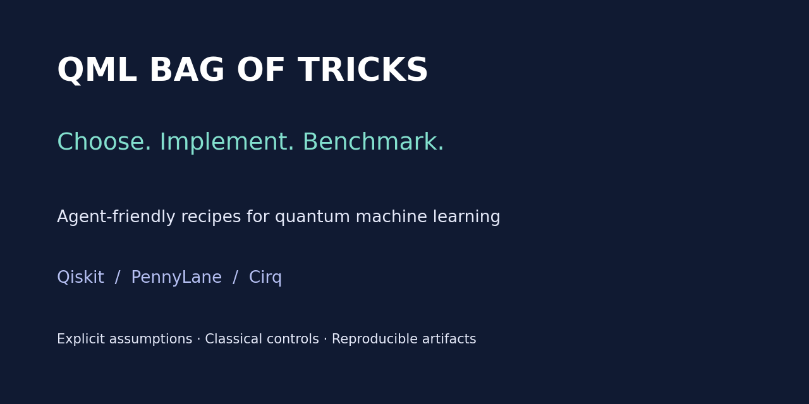

# QML Bag of Tricks

**Choose a QML method. Implement it with your coding agent. Benchmark the result.**



Start with the [three executed walkthroughs](tutorials.md) for classification,
regression and a classical deployment surrogate. Inspect the [real-data study](study.md)
and its complete results, including the stronger classical scores in these small
configurations. The [five agent tasks](agent_evaluation.md) show bounded examples
of implementation and independent replay.

For application-specific incentives, explore the [new application benchmarks](applications/index.md):
periodic calibration and late-query quantum-state characterization. Their
[complete results](applications/results.md) compare tuned regularized models,
optimal inference for the selected classical records, and domain-informed
controls that can remove the quantum benefit.

The [classical-application paper reproductions](reproductions/index.md) target
published materials screening and wireless channel equalization, using pinned
author artifacts, fresh numerical runs and stronger classical controls.

The [owner review packet](owner_review.md) collects the outstanding scientific
review. See [release instructions](release.md) for local artifacts and publication.

For dataset projects, use the [learning workflows](learning/index.md) and
[classical pretraining/surrogate audit](learning/pretraining_surrogates.md).

This collection connects published barren-plateau results with runnable Qiskit,
PennyLane, and Cirq examples. Every strategy separates the published guarantee
from the scope of its executable demonstration. Most examples illustrate a
restricted construction; they are not full reproductions of the paper's
asymptotic theorem. See the [coverage ledger](coverage.md).

## Start here

```bash
python -m pip install -e ".[all]"
python -m qml_tricks list
python -m qml_tricks run local_loss --framework qiskit
python -m qml_tricks run local_loss --framework pennylane
python -m qml_tricks run local_loss --framework cirq
```

Use `.[qiskit]`, `.[pennylane]`, or `.[cirq]` for one framework. Python 3.12 is
the reference environment. Clone the repository before installing it.

## Choose by problem structure

| Your situation | Start with | Check first |
|---|---|---|
| Bounded classical features and a weak embedding | [Near-identity encoding](strategies/near_identity_encoding.md) | Data distinguishability and the reference gradient |
| A deep model with a useful initial reference | [Identity blocks](strategies/identity_block_init.md) | Independent copies, shallow blocks, and a nonzero commutator |
| Resolvable gradients but poorly scaled coordinates | [Quantum natural gradient](strategies/natural_gradient.md) | Metric estimation and conditioning; no generic plateau cure |
| Global all-zero target or autoencoder trash register | [Local losses](strategies/local_loss.md) | Does the surrogate preserve the target? |
| Hierarchical quantum features | [QCNN](strategies/qcnn.md) | Input signal and pooling assumptions |
| Low-entanglement state model | [MPS](strategies/mps.md), [TTN](strategies/ttn.md) | Classical tensor-network baseline |
| Multiscale correlations | [MERA](strategies/mera.md) | Geometry and bond-dimension scaling |
| Long sequential circuit, few gates per wire | [Finite local depth](strategies/finite_local_depth.md) | Gate incidence, not just global depth |
| Useful near-identity reference | [Gaussian initialization](strategies/gaussian_init.md) | Nonzero reference signal |
| Known Pauli target | [Observable-aware initialization](strategies/gaussian_mixture.md) | Final-layer distribution table |
| Spatially repeated task | [Correlated parameters](strategies/correlated_parameters.md) | Tying pattern and task symmetry |
| Known local Hamiltonian generators | [Short-time HVA](strategies/constrained_hva.md) | Reference commutator and time threshold |
| Few conserved excitations | [Low-excitation sectors](strategies/low_excitation.md) | Fixed versus extensive particle count |
| Permutation-invariant data | [Equivariant model](strategies/permutation_equivariant.md) | Representation-sector projections |
| Quadratic fermionic structure | [Matchgates](strategies/matchgate.md) | Observable's Majorana degree |
| Controlled dissipative resource | [Engineered dissipation](strategies/engineered_dissipation.md) | Objective faithfulness |
| Non-unital device noise | [Late-layer trainability](strategies/nonunital_noise.md) | Parameter position and input information loss |
| Learning sample statistics | [Local-moment MMD](strategies/mmd_loss.md) | Which distribution differences the kernel misses |

## Read before interpreting results

[Foundations](foundations.md) explains what the diagnostics establish.
[Fundamental-method audit](fundamentals_audit.md) explains prior omissions and the evidence categories.
[Reproduction](reproduction.md) documents measurement accounting and commands.
[Reference results](results.md) contains an exact analytical comparison and the regeneration command.
The collection makes no general quantum-advantage claim and no promise of
training success. A large quantum state space alone establishes neither.
