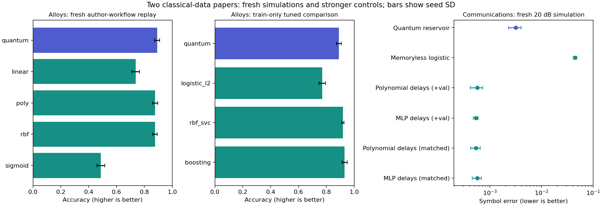

# Classical-application paper reproduction results

These are two classical-input applications. The archive calculation, fresh simulations and stronger-baseline tests are reported separately. No hardware result, new physical material or general quantum advantage is claimed.

## Alloy phases: archived 300-split statistics

This table recomputes the authors’ stored scores; it is **not** 300 new circuit runs. Higher accuracy is better.

| Qubits | Quantum SVC | Linear SVC | Polynomial SVC | RBF-SVC | Sigmoid SVC |
|---|---:|---:|---:|---:|---:|
| 8 | 0.885458 | 0.734064 | 0.858141 | 0.863347 | 0.489256 |
| 10 | 0.894316 | 0.746401 | 0.887995 | 0.881182 | 0.485286 |

The ten-qubit archive mean recovers the reported 89.4% rounded figure. Its best classical archived mean is a different quantity from a modern tuned full-feature baseline.

## Alloy phases: fresh native circuit replay

Twenty fresh quantum evaluations cover seeds 22–31 for each of eight and ten qubits, with four classical comparators each. They retain the pinned author script’s preprocessing, including held-out feature access for scaling. Full SVD uses an explicit legacy PCA sign convention. Each score is compared with the corresponding archived seed.

| Qubits | Quantum SVC | Linear SVC | Polynomial SVC | RBF-SVC | Sigmoid SVC |
|---|---:|---:|---:|---:|---:|
| 8 | 0.889243 | 0.723108 | 0.846614 | 0.852988 | 0.490837 |
| 10 | 0.891235 | 0.737849 | 0.877291 | 0.875697 | 0.487649 |

Maximum absolute fresh-versus-archived quantum score difference on these seeds: **0.000000000000**. The corresponding maximum difference for all 80 classical comparator scores is **0.000000000000**. This is a numerical check, not an assumption that all legacy dependencies are interchangeable.

## Alloy phases: train-only preprocessing and tuned baselines

Ten new stratified 60/20/20 splits use validation-only selection, then train+validation refitting and untouched-test prediction. Quantum selection covers eight/ten qubits and three C values. Classical controls use all 15 raw descriptors and training-only scaling. They have 5 (L2-logistic), 12 (RBF-SVC) and 9 (histogram boosting) candidate configurations.

| Model | Mean test accuracy | Seed SD |
|---|---:|---:|
| quantum | 0.890837 | 0.017437 |
| logistic_l2 | 0.770916 | 0.023021 |
| rbf_svc | 0.918327 | 0.009056 |
| boosting | 0.931474 | 0.018949 |

These rows test a stronger claim than archive recovery. Report them even if the original quantum ordering does not survive. The dataset includes 43 repeated descriptor rows; random row splits do not establish transfer to new composition families. The paper’s full 300-split parameter sweep, language model and alloy-candidate design are outside this reproduction.

## Classical wireless channel equalization

A connected six-qubit reservoir processes classical four-PAM messages distorted by the paper’s nonlinear channel at 20 dB. Three independent seeded datasets each contain 100 training, 20 validation and 100 test messages of 100 symbols. The original quantum readout and memoryless comparator use training messages only; stronger temporal controls refit on train+validation after selecting nine candidates each. Lower symbol error is better.

| Model | Mean test symbol error | Across-seed SD |
|---|---:|---:|
| quantum_reservoir | 0.003133 | 0.000862 |
| memoryless_logistic | 0.044367 | 0.003398 |
| polynomial_delay_logistic | 0.000567 | 0.000153 |
| delay_mlp_l2 | 0.000533 | 0.000058 |
| polynomial_delay_logistic_train_only | 0.000533 | 0.000115 |
| delay_mlp_l2_train_only | 0.000567 | 0.000115 |

Rows ending in `train_only` are a separately recorded post-run fairness audit: the same previously selected classical configurations are fit on exactly the original 100 training messages, matching the quantum model. They introduce no new candidate grid or seed, and the earlier train+validation fits are retained.

Published numerical references at this SNR are 0.0021 error for the ideal connected reservoir and 0.0446 for direct logistic regression. Those are reference values, not regenerated raw datasets. The notebook uses unseeded message generation, so exact printed-number reproduction is not claimed. The fresh results test the stated architecture and ordering on independently generated messages.

The stronger controls use causal eight-sample windows: polynomial per-lag features plus L2 logistic regression, and an L2-regularized MLP. Beating a memoryless classifier does not establish superiority to these or to all classical equalizers. Exact reservoir features here use classical SciPy eigendecomposition and mean-channel contraction, not QPU sampling. The hardware experiment and finite-shot trajectories are excluded.

## Reproducibility and limits

The [reproduction guide](index.md) contains commands and links to the peer-reviewed papers. Pinned author commit IDs, artifact hashes, the original alloy data and its upstream license are under `reproductions/`. Full local predictions and configurations are stored as `results/paper_alloys.json.gz` and `results/paper_communications.json.gz`; `results/paper_summary.json` is readable without decompression.

Run `python scripts/audit_paper_results.py` to independently recompute held-out scores, validate split isolation, validate clean preprocessing fit indices and check artifact hashes. These bounded runs cannot establish hardware speedup or population-wide superiority. Repeated alloy row splits overlap; their SD is descriptive, not an independent-replication confidence interval. Communications has three seeds, not a powered superiority study.

Timing fields are implementation diagnostics, not a matched cost comparison: quantum alloy timing includes feature acquisition and selection, while classical per-model fields cover final refit/prediction. Hardware data loading, shot estimation and compilation would add costs.
