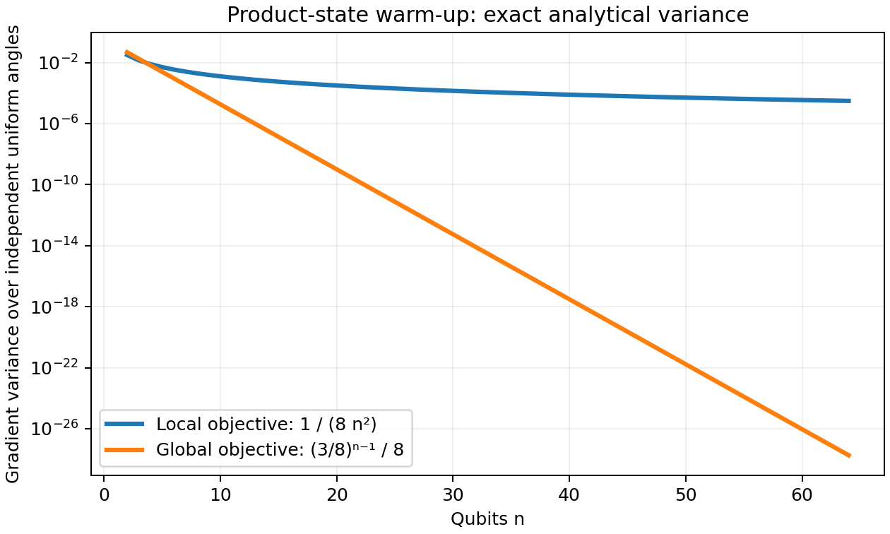

# Reference results



The figure evaluates the exact independent-uniform-angle product-state formulas
from [Cerezo et al.](https://doi.org/10.1038/s41467-021-21728-w).
It is an analytical calculation, not a fit to small simulator experiments.
Both objectives have the same zero set for this particular state-preparation task.

`results/reference.json` contains one-step four-qubit native runs for all 19
recipes in all three SDKs, with seeds, versions, source hashes, diagnostic
statistics, controls described in metadata, and logical resource counts. These
are execution references rather than evidence of an asymptotic advantage or a
complete reproduction of each publication.

Regenerate from the repository root:

```bash
python scripts/reference_results.py
```

The script also writes `results/analytic_variance.json`, a bibliography of
primary-result links, and PNG/SVG versions of the figure. It uses Matplotlib,
which is a dependency of the combined reference environment through Cirq.
