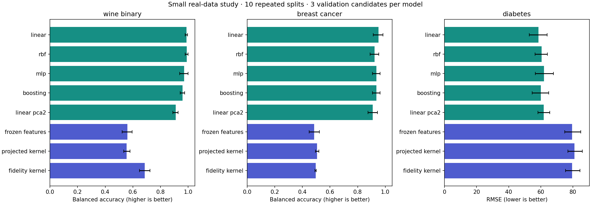

# Small real-data benchmark study



## What was measured

The recorded run contains 240 selected model/split evaluations across three real-observation datasets, with 0 failed final evaluations. It completed in 81.8 seconds on the recorded machine. Runtime is machine-specific.

Each dataset uses a fixed 128-row subset, ten split seeds and three candidate configurations per model. Candidates see only training/validation data; the selected configuration is refit on train+validation and evaluated once on its untouched test partition. All preprocessing and target scaling is fitted within the relevant fit partition.

Full-feature classical models and a two-PCA-component classical linear control are included. The three quantum models use two qubits, one layer and ideal native Qiskit simulation. Equal trial counts do not imply equal compute budgets; every candidate records time, warnings and available circuit/measurement costs.

## Observed results

| Dataset | Model | Metric | Mean | Seed SD | Descriptive 95% interval | Mean selection/refit seconds |
|---|---|---|---:|---:|---|---:|
| wine_binary | linear | balanced_accuracy | 0.9893 | 0.0173 | [0.9786, 0.9964] | 0.039 |
| wine_binary | rbf | balanced_accuracy | 0.9917 | 0.0176 | [0.9792, 1.0000] | 0.024 |
| wine_binary | mlp | balanced_accuracy | 0.9714 | 0.0541 | [0.9387, 1.0000] | 0.562 |
| wine_binary | boosting | balanced_accuracy | 0.9601 | 0.0269 | [0.9440, 0.9756] | 0.253 |
| wine_binary | linear_pca2 | balanced_accuracy | 0.9101 | 0.0337 | [0.8893, 0.9274] | 0.040 |
| wine_binary | frozen_features | balanced_accuracy | 0.5613 | 0.0639 | [0.5226, 0.5947] | 0.402 |
| wine_binary | projected_kernel | balanced_accuracy | 0.5548 | 0.0384 | [0.5345, 0.5792] | 0.364 |
| wine_binary | fidelity_kernel | balanced_accuracy | 0.6869 | 0.0642 | [0.6476, 0.7238] | 1.238 |
| breast_cancer | linear | balanced_accuracy | 0.9506 | 0.0611 | [0.9122, 0.9833] | 0.042 |
| breast_cancer | rbf | balanced_accuracy | 0.9224 | 0.0541 | [0.8900, 0.9523] | 0.024 |
| breast_cancer | mlp | balanced_accuracy | 0.9357 | 0.0473 | [0.9074, 0.9620] | 0.552 |
| breast_cancer | boosting | balanced_accuracy | 0.9362 | 0.0474 | [0.9074, 0.9631] | 0.242 |
| breast_cancer | linear_pca2 | balanced_accuracy | 0.9090 | 0.0578 | [0.8745, 0.9427] | 0.043 |
| breast_cancer | frozen_features | balanced_accuracy | 0.4856 | 0.0646 | [0.4481, 0.5225] | 0.336 |
| breast_cancer | projected_kernel | balanced_accuracy | 0.5056 | 0.0229 | [0.4938, 0.5198] | 0.342 |
| breast_cancer | fidelity_kernel | balanced_accuracy | 0.4969 | 0.0099 | [0.4906, 0.5000] | 1.160 |
| diabetes | linear | rmse | 58.5529 | 9.4644 | [52.7460, 63.8850] | 0.022 |
| diabetes | rbf | rmse | 60.4409 | 6.7341 | [56.4198, 64.0436] | 0.023 |
| diabetes | mlp | rmse | 62.0554 | 9.4123 | [56.5921, 67.9115] | 0.461 |
| diabetes | boosting | rmse | 59.9898 | 9.0554 | [54.5925, 64.8587] | 0.223 |
| diabetes | linear_pca2 | rmse | 61.7965 | 6.5473 | [58.1777, 65.5567] | 0.029 |
| diabetes | frozen_features | rmse | 79.4996 | 8.6512 | [74.8572, 84.8440] | 0.315 |
| diabetes | projected_kernel | rmse | 81.0006 | 7.6811 | [76.9253, 85.9396] | 0.318 |
| diabetes | fidelity_kernel | rmse | 79.4695 | 7.7478 | [75.4054, 84.4257] | 1.114 |

## Interpretation and limits

The tested classical configurations have better mean predictive scores than these small quantum-feature configurations on all three datasets. This is a result about the recorded pipelines, subset sizes and tuning grids. It is not a conclusion about every QML method or every dataset. Representation compression, angle encoding, circuit family and readout all change the model. The two-feature classical control helps expose, but does not isolate, those effects.

Intervals bootstrap the means across overlapping repeated splits. They are descriptive, not independent-replication confidence guarantees or significance tests. A real-observation dataset can still be too small for practical generalization claims. The medical datasets are numerical research benchmarks, not validated clinical tools.

Only selected hyperparameters have been explored. No noisy hardware runs, broad AutoML search, learning curves over large sample sizes or quantum-advantage evidence are established. The original dataset descriptions and content hashes are stored in results/study.json. No test score was used to select a candidate.

## Reproduce and extend

```bash
python -m qml_tricks.learning.study --seeds 0 1 2 3 4 5 6 7 8 9 --limit 128 --trials 3 --output results/study.json
python scripts/build_study_report.py
```

The study uses the bundled wine (classes 0 and 1), Wisconsin breast-cancer and diabetes observations, avoiding a runtime dataset download. See [scikit-learn dataset provenance](https://scikit-learn.org/stable/datasets/toy_dataset.html) and the embedded original descriptions. These small datasets are explicitly described by scikit-learn as illustrative.

For a larger follow-up, freeze a new protocol before running additional datasets or encoders. Preserve these negative/default-configuration results rather than replacing them with a favorable subset.
