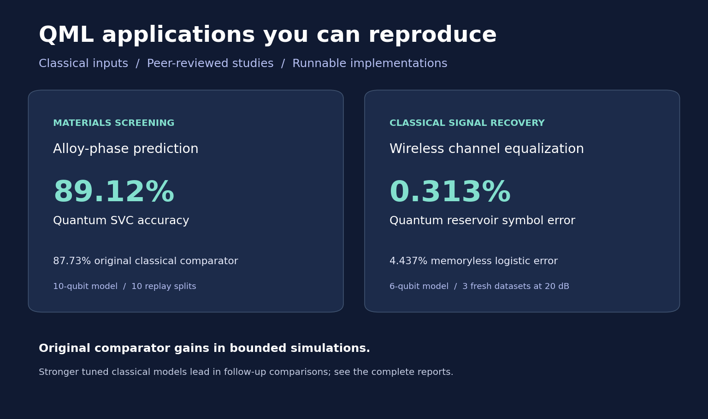

# Why and when to explore QML

Start with a task where the quantum model supplies a useful representation,
temporal memory or measurement protocol. Published applications and reproduced
comparisons give concrete hypotheses to test in a project.

## Two reproduced motivations on classical inputs

| Application | What we reproduced | Starting point |
|---|---|---|
| Alloy-phase screening | Ten-qubit quantum SVC: 89.12% mean accuracy versus 87.73% for the best original classical comparator across ten replay splits | [Alloy implementation and data](reproductions/alloys.md) |
| Wireless channel equalization | Six-qubit reservoir: 0.313% mean symbol error versus 4.437% for direct memoryless logistic regression across three fresh datasets | [Temporal model and signal generator](reproductions/communications.md) |

These are bounded simulations of comparisons from [Pei et al., Matter (2024)](https://doi.org/10.1016/j.matt.2024.05.035)
and [Hu et al., Nature Communications (2024)](https://doi.org/10.1038/s41467-024-51162-7).
The alloy inputs are real materials observations; the communications task uses
simulated classical messages. Stronger tuned classical alternatives lead in
our follow-up comparisons. The [full report](reproductions/results.md) preserves
those comparisons and distinguishes archive recovery from new computation.

### Small experimental datasets: test a different kernel geometry

For materials screening or other costly experiments, a quantum fidelity kernel
offers a task-dependent similarity measure to test alongside conventional
kernels. The alloy replay demonstrates that this geometry can improve on the
specific comparators used in a published application.

Use [fidelity kernels](learning/fidelity_kernel.md) when a quadratic Gram matrix
is affordable. Tune encoding scale, representation and regularization on
training/validation data. Include tuned RBF, linear and domain-informed models.
Check group/family splits before proposing new experiments. The reproduced
gain motivates testing the model; it does not establish a general small-data
advantage or a practical quantum speedup.

### Temporal signals: combine quantum memory with a simple readout

The equalization reproduction shows how a fixed quantum reservoir can transform
streaming inputs into nonlinear features with fading memory, while a convex
classical readout does the supervised learning. This supplies a route to QML
that avoids training a large variational quantum circuit.

Use the [reset-based reservoir example](reproductions/communications.md) for
signal recovery or temporal-response experiments where memory matters. Include
classical delay features, nonlinear equalizers or classical reservoirs with
comparable access to past inputs. Check reset, readout and repeated-execution
costs before considering a hardware implementation.

## Turn the motivation into a trainable implementation

| Your next decision | Repository support |
|---|---|
| Start near a useful reference | [Near-identity encoding](strategies/near_identity_encoding.md) and [identity-block initialization](strategies/identity_block_init.md) |
| Preserve a measurable training signal | [Local costs](strategies/local_loss.md), [QCNNs](strategies/qcnn.md) and task-appropriate symmetries |
| Improve conditioning when gradients are resolvable | [Quantum natural gradient](strategies/natural_gradient.md), with metric estimation and regularization costs |
| Reuse classical learning before quantum training | [Pretraining and warm-start workflows](learning/pretraining_surrogates.md) |
| Deploy a trained quantum teacher through a classical model | [Kipu-style offline feature distillation](learning/kipu_workflow.md), with held-out fidelity gates |

Each guide states the result's assumptions and the executable's scope. A useful
initialization bound, local objective or optimizer does not guarantee a full
training or generalization outcome.

## A separate motivation when the inputs are quantum

If coherent state copies are available and the observable query arrives after
acquisition, [two-copy learning](applications/experimental_learning.md) can
retain information that the tested single-copy local records lose. In the
eight-qubit, 512-copy simulated case, Bell acquisition plus L2 logistic
regression reached 100% mean balanced accuracy versus 49.14% for optimal
inference on those local records. Both protocols use the same total copies;
Bell acquisition requires twice as many simultaneously coherent qubits. An
early-known query removes this observed gap. This is an acquisition benefit
under a specified access model, distinct from the two classical-input papers.

Start with the [executed notebooks](tutorials.md), then reproduce a relevant
application and freeze a benchmark for your own task. Compare predictive
quality, learning-data requirements, acquisition and inference cost together.
